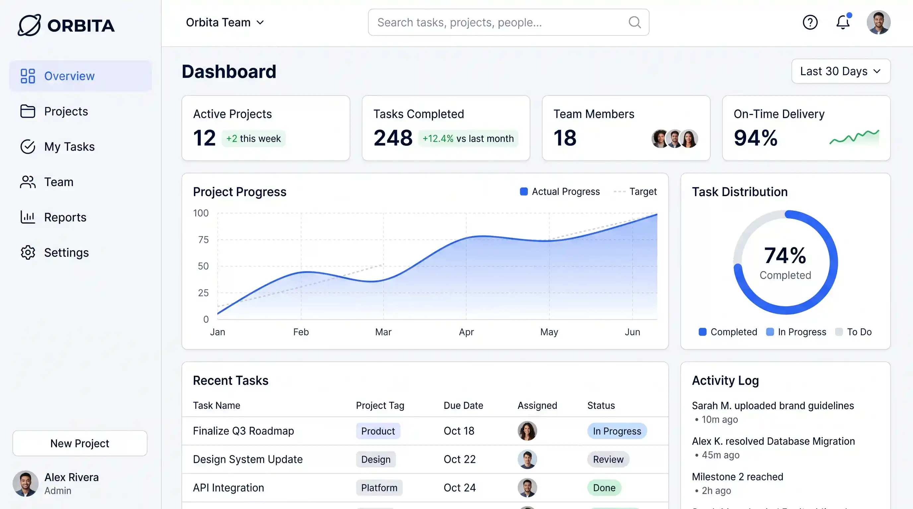

<div align="center">

  

  # Orbita

  **Bring your projects, people, and progress into one orbit.**

  A modern, high-performance SaaS landing page built for next-generation project management, task coordination, and team collaboration.

  [](https://nextjs.org/)
  [](https://react.dev/)
  [](https://www.typescriptlang.org/)
  [](https://tailwindcss.com/)
  [](https://motion.dev/)
  [](https://pnpm.io/)

  <p align="center">
    <a href="https://github.com/usmanmobeen111/Orbita-SAAS-Website-Next.js-Tailwind-Swiper-Motion-TypeScript"><strong>Explore Repository »</strong></a>
    &nbsp;&nbsp;·&nbsp;&nbsp;
    <a href="https://usmanmobeen-blush.vercel.app/"><strong>Developer Portfolio »</strong></a>
    <!-- Live deployment URL placeholder: Add verified production URL once deployed -->
  </p>

</div>

---

## Project Preview

<div align="center">
  
</div>

<!-- Placeholder: Add animated walkthrough GIF or multi-device mockup here when available -->

---

## About the Project

**Orbita** is a clean, conversion-focused frontend interface designed for a modern project management platform. Complex teamwork often suffers from fragmented discussions, scattered task trackers, and disconnected team visibility. Orbita presents a unified workspace narrative where planning, execution, and team members converge.

> **Scope Note**: This repository contains the complete, production-ready frontend marketing and prototype interface for Orbita. It is built as a responsive client-side experience and does not include backend databases, live authentication servers, or external payment gateways.

---

## Key Features

- **Hero & Fluid Navigation**:
  - Sticky glassmorphic navigation with mobile overlay drawer powered by Framer Motion.
  - Keyboard accessibility (Escape key listener) and body scroll lock on mobile viewports.
  - Elastic call-to-action buttons featuring custom `orbita-jelly` physics.
  - Responsive dashboard preview crop that adapts between mobile and desktop viewports.

- **Integrations Ecosystem (`#integrations`)**:
  - Category filtering across Engineering, Design, Collaboration, and Cloud tooling.
  - Dual continuous marquee rows (`animate-marquee` and `animate-marquee-reverse`) with hover-pause behavior and reduced-motion support.

- **People & Culture (`#people`)**:
  - Interactive team roster with department filters (Design Systems, Cloud & Runtime, Strategy, DevRel).
  - Live status indicators (e.g., *"Designing in Figma"*, *"Reviewing PR #512"*), team impact metrics, and expandable bios.

- **Core Solutions (`#features`)**:
  - Solution cards for Project Management, Task Management, and Team Collaboration.
  - Interactive top-right decorative grid masks (`.feature-card-grid`) and subtle icon ripple micro-animations on hover.

- **Workspace Showcase (`#workspace`)**:
  - Multi-card dashboard layout visualizing real-world product workflows:
    - **Project Overview**: Milestone progress tracker, task count badges, and recent activity feed.
    - **Task Management**: Interactive checklist with status tags (*On track*, *In progress*, *Done*).
    - **Team Collaboration**: Active user avatars, real-time presence indicators, and comment threads.
    - **Progress & Analytics**: Weekly completion velocity chart and key delivery metrics.

- **Testimonials & Social Proof (`#testimonials`)**:
  - 4.9/5 aggregate rating badge with star breakdown and user avatar clusters.
  - Distinct customer quote cards styled with balanced padding and typography.

- **Tiered Pricing (`#pricing`)**:
  - Interactive Monthly / Yearly billing toggle reflecting annual savings.
  - Three distinct plans: Basic, Pro (highlighted with landscape card artwork and badge), and Enterprise.

- **Responsive Footer (`#footer`)**:
  - Soft-faded landscape background with cross-browser mask gradient.
  - Exact brand logo and wordmark structure aligned with the top navigation.
  - Mobile-first newsletter input and Subscribe CTA.
  - Balanced bottom bar containing copyright notice, developer credit, and accessible social links (GitHub, Portfolio, LinkedIn, Instagram).

---

## Tech Stack

| Layer | Technology | Version | Purpose |
| :--- | :--- | :--- | :--- |
| **Framework** | [Next.js](https://nextjs.org/) | `16.4.2` | App Router, Server Components & asset optimization |
| **Library** | [React](https://react.dev/) | `19.3.0` | Declarative UI and component lifecycle |
| **Language** | [TypeScript](https://www.typescriptlang.org/) | `^5.0` | Strict static typing and interface definitions |
| **Styling** | [Tailwind CSS](https://tailwindcss.com/) | `^4.3.3` | Utility-first styling with `@theme` token configuration |
| **Motion** | [Motion](https://motion.dev/) / Framer Motion | `^14.3.0` | Spring animations and mobile drawer transitions |
| **Icons** | [React Icons](https://react-icons.github.io/react-icons/) & [Lucide](https://lucide.dev/) | `^5.7.0` / `^1.59.0` | Brand and interface iconography |
| **Package Manager**| [pnpm](https://pnpm.io/) | `11.18.0` | Fast, deterministic dependency management |

---

## Design System

Orbita pairs a high-contrast corporate palette with editorial serif typography to convey clarity, structure, and calm focus.

### Color Palette

- **Primary Blue** (`#2563EB`): Brand accent, primary action buttons, active states.
- **Navy** (`#0F172A`): Headings, wordmarks, high-contrast dark accents.
- **Pale Blue** (`#EFF6FF`): Subtle badges, icon surfaces, soft backgrounds.
- **Slate** (`#64748B` / `#475569`): Readable secondary copy and metadata.
- **White** (`#FFFFFF`): Main surface panels and elevated card containers.

### Typography

- **Body & Interface**: `Poppins`, `sans-serif` — Crisp, legible geometric text.
- **Modern Sans**: `Outfit`, `sans-serif` — Used across badges and select UI controls.
- **Editorial Accents**: `DM Serif Display`, `serif` — Italicized focal points in headlines (e.g., *"and progress into one orbit"*).

### Responsive Strategy

Layouts are crafted mobile-first and expand intentionally across Tailwind breakpoints:
- `base`: Compact mobile viewports with vertical stacking and touch-friendly targets.
- `md:`: Tablet viewports with relaxed gaps and rearranging grid columns.
- `lg:` / `xl:`: Spacious desktop layouts with multi-column grids and balanced typography.
- `2xl:`: Ultra-wide desktop framing with centered maximum container widths.

---

## Getting Started

### Prerequisites

Ensure you have the following installed on your machine:
- **Node.js**: `v20.x` or higher recommended
- **pnpm**: `v9.x` or higher (`corepack enable pnpm` or `npm install -g pnpm`)

### Installation

1. **Clone the repository**:
   ```bash
   git clone https://github.com/usmanmobeen111/Orbita-SAAS-Website-Next.js-Tailwind-Swiper-Motion-TypeScript.git
   cd Orbita-SAAS-Website-Next.js-Tailwind-Swiper-Motion-TypeScript
   ```

2. **Install dependencies**:
   ```bash
   pnpm install
   ```

3. **Start the local development server**:
   ```bash
   pnpm dev
   ```

4. **View in browser**:
   Open [http://localhost:3000](http://localhost:3000) to view the application.

> **Environment Variables**: No external `.env` variables are required to run this project. All assets and prototype data are packaged locally.

### Available Scripts

| Command | Action |
| :--- | :--- |
| `pnpm dev` | Starts the local development server at `localhost:3000` |
| `pnpm build` | Compiles an optimized production build |
| `pnpm start` | Serves the generated production build locally |
| `pnpm lint` | Runs ESLint validation across project files |

---

## Project Structure

```text
Orbita/
├── app/
│   ├── components/
│   │   ├── FeatureCards.tsx      # Feature card with ripple animation & grid mask
│   │   ├── Features.tsx          # Solutions overview section (#features)
│   │   ├── Footer.tsx            # Responsive footer, social links, credit
│   │   ├── Hero.tsx              # Hero headline, CTA & dashboard preview
│   │   ├── Navbar.tsx            # Responsive header & animated mobile drawer
│   │   ├── NewsletterForm.tsx    # Mobile-first email subscription form
│   │   ├── Pricing.tsx           # Billing frequency toggle & pricing grid (#pricing)
│   │   ├── PricingCard.tsx       # Individual tier card with backdrop artwork
│   │   ├── Showcase.tsx          # Workspace dashboard cards & analytics chart (#workspace)
│   │   ├── TeamSection.tsx       # Filterable team showcase with status tags (#people)
│   │   ├── Testimonials.tsx      # Social proof, rating summary & reviews (#testimonials)
│   │   └── TrustedBy.tsx         # Category filter & dual-track logo marquee (#integrations)
│   ├── favicon.ico               # Browser tab icon
│   ├── globals.css               # Font imports, Tailwind theme tokens & animations
│   ├── layout.tsx                # Root layout & page metadata
│   └── page.tsx                  # Single-page assembly of all sections
├── public/                       # Static SVGs, photography & partner logos
│   ├── logos/                    # Integration logos (GitHub, Figma, Slack, etc.)
│   ├── team/                     # Team member avatar photography
│   ├── hero_dashboard.webp        # High-resolution dashboard composition
│   ├── orbita.svg                # Brand icon and vector mark
│   └── showcase.webp              # Atmospheric background artwork
├── eslint.config.mjs             # ESLint flat configuration
├── next.config.ts                # Next.js compilation options
├── package.json                  # Dependencies, scripts, and metadata
├── pnpm-lock.yaml                # Lockfile for reproducible installs
├── postcss.config.mjs            # PostCSS configuration for Tailwind v4
├── tsconfig.json                 # TypeScript compiler configuration
└── README.md                     # Project documentation
```

---

## Future Enhancements

Potential iterations for turning this landing page into a full-stack SaaS platform:

- [ ] **Authentication**: Add NextAuth / Clerk integration for secure sign-in and user onboarding.
- [ ] **Backend Database**: Connect Prisma / Supabase to enable dynamic task and workspace CRUD.
- [ ] **Live Newsletter**: Wire up the footer newsletter form to Resend, ConvertKit, or Mailchimp.
- [ ] **Theme Mode**: Add a dark mode toggle utilizing Tailwind dark tokens.
- [ ] **Internationalization**: Support multi-language localized copy via `next-intl`.

---

## Author & Acknowledgments

- **Designed and Developed by**: **Usman Mobeen**
  - **Portfolio**: [usmanmobeen-blush.vercel.app](https://usmanmobeen-blush.vercel.app/)
  - **GitHub**: [@usmanmobeen111](https://github.com/usmanmobeen111)
  - **LinkedIn**: [in/usmanmobeen111](https://www.linkedin.com/in/usmanmobeen111/)
  - **Instagram**: [@thecodeweaver111](https://www.instagram.com/thecodeweaver111/)

### License

No license has been specified for this project yet. All rights reserved by the author.

---

<div align="center">
  <sub>Bring your projects, people, and progress into one orbit. Built with Next.js and Tailwind CSS.</sub>
</div>
